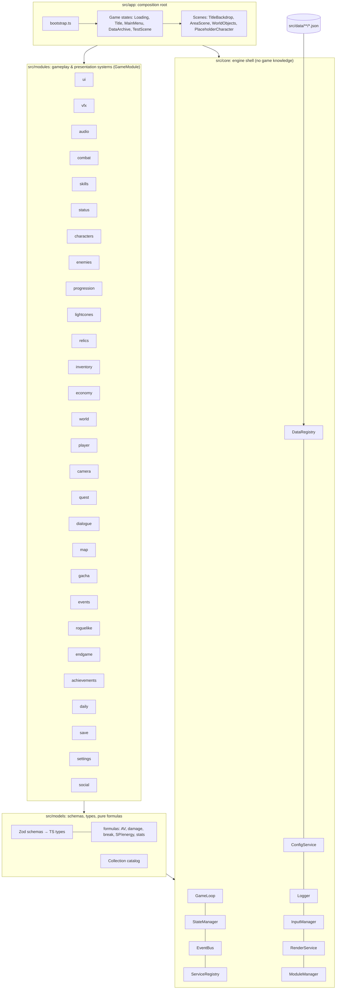
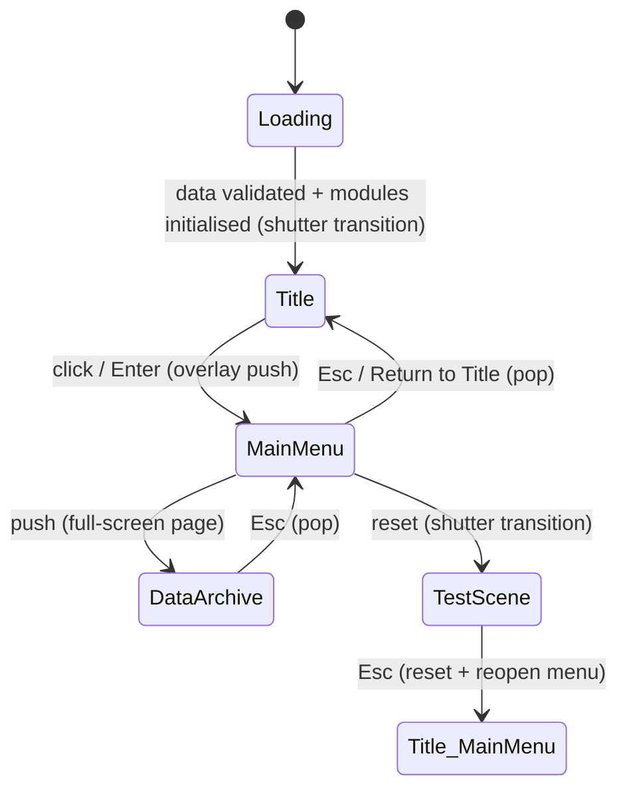

# Astral Rail: Architecture

> Astral Rail is an original fan project that recreates the gameplay structure of a turn-based space-fantasy RPG in the style of *Honkai: Star Rail*. All names, art, audio, icons and fonts are original, procedurally generated, or openly licensed (fonts: Barlow, SIL OFL). No assets from the reference game are used.

This document covers spec section 39 ("FIRST ACTION"), steps 1–5 and 7: spec analysis, engine selection, technology stack, project architecture, folder structure and system dependencies. Data models are in [DATA_MODELS.md](DATA_MODELS.md), and the 26-phase plan is in [ROADMAP.md](ROADMAP.md).

---

## 1. Specification analysis

The spec (`docs/SPEC.md`) describes a full live-service RPG loop:

```
EXPLORE → ENCOUNTER → TURN-BASED COMBAT → REWARDS → PROGRESSION → EQUIPMENT → STORY → NEW AREAS → ENDGAME
```

Analysing its 39 sections gives these architectural requirements:

| Concern | Spec sections | Consequence for the architecture |
|---|---|---|
| **Deterministic, data-heavy combat.** AV timeline, SP, energy, toughness, 7 break effects, damage zones, follow-ups, counters, DoTs, CC | 2, 3, 5, 11, 12, 28 | Pure, side-effect-free formula layer (`src/models/formulas`). Presentation-free combat engine driven by data and events, so it can run headless in tests and simulations. |
| **Many content types that grow forever.** Characters, enemies, light cones, relics, items, quests, banners, events | 4, 6–11, 14, 15, 18–25 | Everything is data. There is one schema per content type, one registry, cross-reference validation at load, and no content in code. |
| **Characters must not require engine changes** | 4 | Abilities are lists of typed effects plus triggers. Anything unusual goes through named script handlers registered by id (the `script` effect). |
| **Strict system separation** (combat, characters, enemies, skills, status, inventory, relics, LC, quest, dialogue, world, UI, audio, VFX, save, economy, gacha, events, endgame) | 36 | 28 `GameModule`s, each with a public interface, a DI token and declared dependencies. The `ModuleManager` initialises them in topological order. |
| **Exploration, cameras, cinematics** | 13, 14, 17, 29, 30 | Real-time 3D renderer with a fixed-step simulation loop, a scene/state stack and smooth transitions. |
| **Polished anime sci-fi UI, ~21 screens** | 27, 28 | A DOM overlay over the WebGL canvas, which gives crisp vector UI, CSS animation and accessibility, plus a layer/screen framework and a theme. |
| **Settings, rebinding, accessibility, language** | 34 | Typed config service with layered overrides. Input is action-mapped from data, so rebinding only edits data. |
| **Save everything** | 33 | Versioned save schema. Modules contribute their slices through `SaveProvider`s, so the save module never knows gameplay internals. |
| **Performance** (stable FPS, pooling, LOD, streaming) | 35 | Fixed-step loop with clamped frames, lazily loaded data chunks, instancing, per-view post-processing toggled by quality preset, throttled debug UI. |
| **Server-authoritative gacha if online** | 19, 26 | RNG sits behind a `WarpAuthority` interface. The offline build uses a local authority. |
| **Development rule** (no hacks, no duplicates, nothing hardcoded) | 38 | All tunables live in `src/data/**` (combat rules, curves, bindings, config). Shared formulas exist exactly once. Strict data validation fails the build/test on errors. |

## 2. Engine selection

| Option | Verdict |
|---|---|
| Unity / Godot | Not available in this environment. They also don't satisfy "runs via `npm run dev` in a browser" without exporting. |
| Babylon.js | Capable, but heavier, and the extra built-in systems (GUI, physics) would overlap with our own data-driven systems. |
| PlayCanvas / Phaser | PlayCanvas is editor-centric. Phaser is 2D-first. |
| **Three.js + TypeScript (chosen)** | Mature WebGL renderer with a post-processing stack (bloom, tone mapping), small API surface, full control over architecture, and excellent TypeScript types. It runs anywhere a browser runs, including headless Chromium for automated screenshots. |

**Why this is a good fit:** the spec cares most about *systems* (combat math, progression, data). A thin rendering library plus our own engine shell (loop, states, DI, events, data) keeps those systems engine-agnostic and testable in Node. Three.js covers what we need visually: PBR materials, custom shaders for the procedural sky, planets and rails, instancing and bloom.

## 3. Technology stack

| Layer | Choice | Notes |
|---|---|---|
| Language | **TypeScript 5.9**: `strict`, `noUncheckedIndexedAccess`, `noImplicitOverride`, `verbatimModuleSyntax` | Every module is typed end-to-end. Data types are inferred from schemas. |
| Build / dev server | **Vite 8** | Fast HMR, `import.meta.glob` for lazy per-file data chunks, production build to `dist/`. |
| Rendering | **Three.js r186** | WebGL2, ACES tone mapping, `EffectComposer` + `UnrealBloomPass` + `OutputPass`. |
| Schemas / validation | **Zod 4** | One source of truth: runtime validation + static types (`z.infer`). |
| UI | DOM + CSS (no framework) | A tiny `h()` builder, layered `UiRoot`, CSS theme tokens, original SVG icon set. |
| Fonts | `@fontsource/barlow`, `@fontsource/barlow-condensed` (OFL) | Bundled locally, so the game works offline. |
| Unit tests | **Vitest 4** | Runs in Node. Covers core, formulas, schemas and all shipped data. |
| E2E / screenshots | **Playwright 1.63** (Chromium, SwiftShader) | `npm run screenshots` drives the full boot flow, repeats menu / archive / test scene at 1280×720, 1024×768 and 390×844 with automated overlap, cut-off and overflow checks, and fails on console errors or layout problems. |
| Lint | **ESLint 10** + `typescript-eslint` | Forbids `console.*` outside the logger and enforces type-only imports. |

## 4. Architecture overview



**Layering rule:** dependencies only point downwards (`app → modules → models → core`). `core` knows nothing about the game, and `models` know nothing about rendering. Modules talk to each other through DI tokens and the typed event bus, never through concrete classes.

### 4.1 Core engine shell (`src/core`)

| Service | File | Responsibility |
|---|---|---|
| `GameLoop` | `loop/GameLoop.ts` | Fixed-timestep simulation (`fixedUpdate`, 60 Hz by default), per-frame `update`, interpolated `render(alpha)`. Clamps long frames, caps steps per frame (prevents the spiral of death), supports pause and time scale (combat speed ×2, slow-motion ultimates). The scheduler is injectable for deterministic tests. |
| `StateManager` | `state/StateManager.ts` | Stack of game states (`push`, `pop`, `replace`, `reset`) created from registered factories. Operations are queued and serialised, so double-clicks during transitions are safe. Provides pause/resume focus hooks and overlay states (menus over a live 3D backdrop). An optional `StateTransitioner` (UI shutters) wraps any operation. |
| `EventBus<GameEvents>` | `bus/EventBus.ts` | Typed pub/sub with priorities, `once`, `onAny`, `waitFor`, and error isolation. Modules extend `GameEvents` through TypeScript declaration merging (see `modules/combat/index.ts`), so events stay type-checked without a central god-file. |
| `ServiceRegistry` | `di/ServiceRegistry.ts` | Typed DI tokens, values, lazy singleton or transient factories, circular-dependency detection, child scopes (e.g. per battle). |
| `DataRegistry` | `data/DataRegistry.ts` | Loads every JSON file from a `DataSource`, maps it to a collection by directory, validates it with its Zod schema, indexes items by id, detects duplicates, runs semantic validators, and verifies cross-collection references. Reports per-file progress, and is strict (throws) or lenient. |
| `ConfigService` | `config/GameConfig.ts` | Typed engine config. Defaults are **data** (`src/data/config/game.config.json`). URL overrides (`?cfg.graphics.quality=low`) and, from Phase 21, saved user settings are layered on top. Updates are validated atomically. |
| `Logger` | `log/Logger.ts` | Namespaced child loggers, level filtering, pluggable sinks (console + ring buffer for the debug overlay). |
| `InputManager` | `input/InputManager.ts` | Keyboard, mouse, wheel and gamepad mapped to named **actions** from data (`src/data/input/default.json`). Provides `isDown`, `wasPressed`, `wasReleased`, `axis`, pointer and wheel deltas, release-all on blur, and per-frame edge clearing. |
| `RenderService` | `render/RenderService.ts` | The single `WebGLRenderer` and canvas. States create `RenderView`s (scene + camera + optional bloom). It handles resizing for all live views, applies graphics settings, and gathers per-frame stats across all passes. |
| `ModuleManager` | `modules/ModuleManager.ts` | Registers `GameModule`s, sorts them topologically (rejects cycles and unknown deps), initialises them with child loggers, ticks them, and disposes them in reverse order. |

### 4.2 Game modules (`src/modules`)

Each module folder exports a **public interface** (its system contract), a **DI token** and a **`GameModule` descriptor** with `phase` and `dependsOn`. In Phase 1, 26 modules are stubs and 2 are partially implemented: `ui` (screen framework, transitions, theme, icons) and `vfx` (procedural starfield, nebula, planet). The dependency graph in [ROADMAP.md §3](ROADMAP.md#3-system-dependency-graph) is enforced by unit tests against the real module list.

Key design decisions per area:

- **Combat** is presentation-free. It consumes `UnitFactory` implementations registered by `characters` and `enemies` (built from a `UnitBuildSpec`: the player's `CharacterInstance` with its Light Cone and relics, an enemy id and level, or an owned memosprite/summon) and emits `combat:*` events. Its runtime model already distinguishes characters, memosprites, enemies and summons, and queues inserted actions (follow-ups, counters, extra turns) separately from player Ultimates. UI, camera, VFX and audio react to those events, so a new character never touches the engine.
- **Player (Phase 2)** is a pure, deterministic simulation (`modules/player`): movement math, a static collision world (capsule footprint vs axis-aligned boxes and ramps, step-up, slope limit, ground snap, gravity), a data-driven animation state machine, the party roster and the interaction prompt list, combined in `OverworldController.step(dt, ControlInput)`. The app state turns the action map (keys, mouse, gamepad sticks) into `ControlInput`, runs the controller in fixed 1/60 s sub-steps, renders the result and forwards its hook events (`player:footstep`, `player:interact`, `player:technique`, `player:overworldAttack`, `player:leaderChanged`, `player:animationState`) to the bus.
- **Camera (Phase 3)** is pure TypeScript (`modules/camera`). A `CameraDirector` keeps a priority stack of providers (the exploration rig at the bottom, data-defined shots above it), picks the highest priority (the latest wins ties), and blends with data curves and durations or cuts. It layers trauma shake and the letterbox on top, and outputs a `CameraPose` that the app applies to the single THREE camera. Scripted providers gate the player's input. The exploration rig sphere-casts from the player's head against the level colliders, so the camera is pulled in, or lifted over the player, before any wall can hide them.
- **World (Phase 4)** is pure TypeScript (`modules/world`). `WorldRuntime` loads one area at a time from JSON (live collider list, typed objects, puzzles, hidden areas, enemy spawns) and owns the interactable state machines, requirements, rewards, enemy AI and encounter advantage. Persistent facts live in an id-keyed, versioned `WorldState`; transient ones (enemy positions, plate occupancy) stay in the runtime. It publishes typed `world:*` events for the quest layer and never renders. The app state feeds it the player pose and the F / attack / Technique actions, renders it through `AreaScene` and `WorldObjectsView`, and rebuilds the area behind the transition overlay. The world graph (World -> Region -> Area) is validated at load.
- **Battle (Phase 5A)** is a deterministic, presentation-free engine (`modules/combat`): `Battle` (timeline, resources, the ultimate and inserted-action queues, targeting, the damage and break pipeline, status runtime, enemy AI, loot) driven by `step()` / `submit()`, with a seeded RNG stream and a typed `BattleEvent` log. Unimplemented effects and script handlers are declared stubs (`stubs.ts`) that log visibly. The app side (`BattleState`, `BattleScene`, `BattleHud`, `BattleSandboxState`) subscribes to the events, animates them with the camera director and returns a `BattleResult` to the caller (the exploration scene applies it to `WorldState`). Tuning is data: `rules/combat`, `combat/stage`, `camera/shots/battle`, `loot-tables`.
- **Skills** interprets data-defined abilities (an ordered list of `effects`, plus `triggers` from a fixed event vocabulary and `conditions` from a closed type list). The escape hatch for unique kits is `{ "kind": "script", "handler": "<id>" }`, resolved from a handler registry. Every description is a template filled from the same data (`models/templates.ts`), validated at load.
- **Status** owns buffs, debuffs, DoTs, CC and shields. The seven Weakness Break effects are ordinary data-defined statuses.
- **Economy** is the single ledger for currencies and stackable items (spec §20, "keep economy calculations centralized"). Inventory, shops, gacha and progression all spend and grant through it.
- **Gacha** puts RNG behind `WarpAuthority`, so it can move server-side.
- **Events** (live events) are plugins with their own schedule and content.
- **Save** collects slices from `SaveProvider`s, so the save format stays modular.

### 4.3 Models (`src/models`)

Zod schemas are the single source of truth for data shapes. TypeScript types are inferred from them (`z.infer`), so the two can never drift apart. Runtime-only shapes (combat state, player-owned instances, save game) are plain interfaces. Pure functions in `src/models/formulas` implement the reference mechanics and read every constant from `rules/*.json`. The collection catalog (`collections.ts`) declares each content type once: directory, format, schema, cross-references and semantic checks.

### 4.4 App layer (`src/app`)

`bootstrap.ts` is the only place that knows concrete implementations. It builds config, logging, bus, UI root, renderer, input, data, modules and the state manager, registers states, wires the loop, and exposes a debug handle (`window.__ASTRAL__`) for tooling.

**Boot flow (Phase 1):**



## 5. Folder structure

```
HSR/
├─ docs/                    SPEC, ARCHITECTURE, DATA_MODELS, ROADMAP, PHASE_REPORT, screenshots/
├─ scripts/screenshots.mjs  Playwright E2E smoke test + screenshot capture
├─ scripts/import-reference-data.mjs + reference-data/   Reference-data importer (kits, cones, enemies, relics)
├─ index.html               Single page; mounts #app
├─ src/
│  ├─ main.ts               Entry point → app/bootstrap
│  ├─ app/                  Composition root (only layer that knows concrete classes)
│  │  ├─ bootstrap.ts       Builds services, registers states/modules, starts loop
│  │  ├─ AppContext.ts      Typed bundle passed to states; state ids
│  │  ├─ dataSource.ts      Vite glob → lazy per-file data chunks
│  │  ├─ states/            LoadingState, TitleState, MainMenuState, DataArchiveState, TestSceneState
│  │  └─ scenes/            TitleBackdrop (procedural express), AreaScene, WorldObjects, PlaceholderCharacter
│  ├─ core/                 Engine shell (game-agnostic)
│  │  ├─ bus/ config/ data/ di/ input/ log/ loop/ modules/ render/ state/
│  │  ├─ events.ts          GameEvents map (extended by modules)
│  │  └─ tokens.ts          DI tokens for core services
│  ├─ models/               Zod schemas, TS types, pure formulas
│  │  ├─ common, stats, scaling, ability, status, character, enemy, lightcone,
│  │  │  relic, item, gacha, quest, rules, combat (runtime), save, locomotion, camera, world
│  │  ├─ collections.ts     Collection catalog (dir, schema, refs, validators)
│  │  └─ formulas/          actionValue, damage, toughness, resources, stats
│  ├─ modules/              One folder per system (public interface + token + GameModule)
│  │  ├─ player camera world combat skills status characters enemies progression
│  │  ├─ lightcones relics inventory economy quest dialogue map ui gacha events
│  │  ├─ roguelike endgame achievements daily save settings audio vfx social
│  │  ├─ ui/                UiRoot, TransitionOverlay, dom, icons, screens/, styles/
│  │  ├─ vfx/               Starfield, Nebula, Planet (procedural)
│  │  └─ index.ts           ALL_MODULES
│  └─ data/                 ALL game content and tunables (JSON)
│     ├─ config/            game.config.json (engine defaults)
│     ├─ rules/             combat/, progression/, scaling/
│     ├─ elements/ paths/ status-effects/ characters/ enemies/ loot-tables/
│     ├─ light-cones/ relics/{sets,stat-tables}/ items/ cost-tables/
│     ├─ banners/ quests/ dialogues/ input/ ui/tips/ script-handlers/
│     ├─ worlds/ levels/ parties/ camera/ rules/world/      (Phase 2 to 4 world content)
└─ tests/                   core/, models/, data/, player/, camera/, world/ (Vitest)
```

## 6. Data-driven pipeline

```mermaid
flowchart LR
  J[JSON file in src/data/&lt;dir&gt;] -->|import.meta.glob, lazy chunk| S[DataSource]
  S --> R{DataRegistry}
  R -->|collection by longest dir prefix| Z[Zod schema parse + defaults]
  Z -->|ok| I[Indexed by id]
  Z -->|issues| E[DataIssue: file, path, message]
  I --> V[Semantic validators: eidolon order, trace parents, boss phases, description placeholders, LC params...]
  I --> X[Cross-refs: statuses, items, cost tables, loot, summons, banner pools]
  V & X --> Rep[LoadReport → strict: throw / lenient: log]
  I --> Sys[Systems & UI read typed items: data.get(Collections.characters, id)]
```

To add content, drop a JSON file into the right folder. To add a new **kind** of content, write one schema and add one catalog entry. `tests/data/content.test.ts` validates every shipped file on every test run, and `tests/data/reference.test.ts` pins reference-game values.

**Reference content (Revision 2).** Characters, Light Cones, enemies, relic sets, items and Trace costs are real Honkai: Star Rail data. They are generated by `npm run import:reference` (`scripts/import-reference-data.mjs` + `scripts/reference-data/`) from pinned datamined sources (StarRailRes and TurnBasedGameData; see [DATA_SOURCES.md](DATA_SOURCES.md)). The kit modules map mechanics to reference parameters, the sources supply every number, and the importer asserts that promotion growth matches `rules/progression`. Unique mechanics are named script handlers, documented in `src/data/script-handlers/handlers.json`, and the registry rejects any undocumented handler.

## 7. Conventions and spec §38 compliance

- **No hardcoded tunables.** SP limits, energy values, AV numerator, cycle lengths, RES defaults, DEF constants, toughness multipliers, break multipliers and delays, the full break level-multiplier table (with its cited source), growth curves, relic stat tables, gacha rates, key bindings, loading tips and engine settings all live in `src/data`.
- **No duplicate implementations.** Each formula exists once in `models/formulas` and is reused by the Data Archive UI, the tests and (later) the combat engine. The starfield and nebula are shared by the title and test scenes.
- **No temporary hacks.** Every stub implements the real public interface its phase will fill in. The Phase-3 camera's `ExplorationProvider` implements the `ExplorationCamera` contract that the player controller relies on (it only reads `yaw`). It replaced the Phase-2 follow camera without any controller change.
- **Events** are named `domain:verb` (`state:changed`, `combat:weaknessBreak`).
- **Ids** are lower-case dotted (`char.seele`, `break.wind-shear`) and validated by schema.
- **Percent values** are fractions (`0.12` = 12%).

## 8. Performance strategy (spec §35)

| Technique | Status |
|---|---|
| Fixed-step simulation with clamped frames and capped catch-up | Phase 1 ✔ |
| Lazy per-file data chunks; vendor chunks split (`three`, `zod`) | Phase 1 ✔ |
| Instanced geometry (rail ties), shared materials, dispose-on-exit for every state | Phase 1 ✔ |
| Bloom only when `graphics.bloom` and quality ≠ low; pixel-ratio cap; quality scale | Phase 1 ✔ |
| Full-screen pages pause the 3D view below instead of rendering it | Phase 1 ✔ |
| Throttled debug overlay (4 Hz), DOM screens updated in place | Phase 1 ✔ |
| Object pooling (VFX, damage numbers), LOD, frustum/occlusion culling, asset streaming per area | Phases 4, 23, 24 |

## 9. Testing strategy

- **Unit (Vitest, Node):** core services, pure formulas against known reference values, schema rejection cases, and the full shipped dataset (schema + references + mechanics invariants such as SP 3/5 and break multipliers).
- **Module graph:** the real `ALL_MODULES` list must be acyclic, complete per spec §36, and bootable headlessly.
- **E2E (Playwright):** boots the production build, walks Loading → Title → Menu → Archive → Test Scene → back, exercises input (incl. the F3 debug overlay), then repeats the menu, archive and test scene at 1280×720, 1024×768 and 390×844. It fails on any console or page error, on unresolved description placeholders, and on layout problems (horizontal overflow, overlapping or cut-off UI), and saves screenshots.
