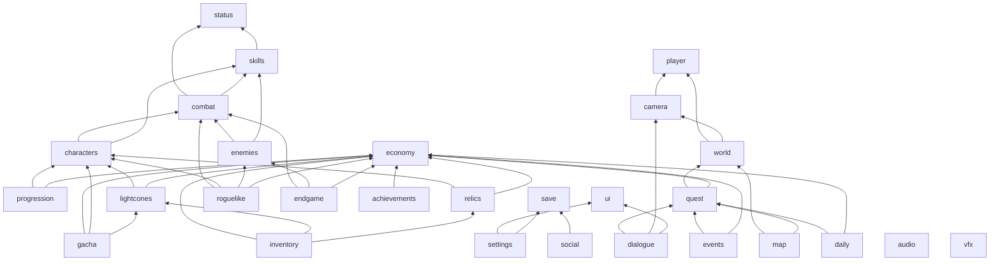

# Astral Rail: Development Roadmap

The roadmap follows spec §37 (26 sequential phases). Each phase applies the §38 development rule: explain architecture, identify dependencies, implement, test, fix, refactor, verify existing systems, and only then move on. **A phase starts only after the previous phase is validated.**

Legend: ✅ done · 🟡 partially present (framework or stub) · ⬜ not started

## 1. Phase overview

| # | Phase | Main modules | Depends on phases | Status |
|---|---|---|---|---|
| 1 | Project architecture | core, models, all module stubs, ui (framework), vfx (backdrop) | — | ✅ |
| 2 | Player controller | player | 1 | ✅ done (exploration test level) |
| 3 | Camera | camera | 2 | ✅ done (director, exploration rig, shots, Camera Gallery) |
| 4 | World exploration | world | 2, 3 | 🟡 interface |
| 5 | Combat engine | combat, skills, status | 1 | 🟡 interfaces + formulas |
| 6 | Character framework | characters | 5 | 🟡 interface + data |
| 7 | Enemy framework | enemies | 5 | 🟡 interface + data |
| 8 | Weakness system | combat (break), status | 5, 6, 7 | 🟡 formulas + break data |
| 9 | Character progression | progression, economy (ledger) | 6 | 🟡 interface + rules |
| 10 | Light Cones | lightcones | 6, 9 | 🟡 interface + data |
| 11 | Relics | relics | 6, 9 | 🟡 interface + stat tables |
| 12 | Inventory | inventory, economy (shops) | 9, 10, 11 | 🟡 interface |
| 13 | Quest system | quest | 4, 9 | 🟡 interface + schema |
| 14 | Dialogue | dialogue | 3, 13, 16(framework) | 🟡 interface + schema |
| 15 | World / map | world, map | 4, 13 | 🟡 interface |
| 16 | UI | ui, settings | 1–15 | 🟡 framework + theme |
| 17 | Gacha / Warp | gacha | 6, 10, 12 | 🟡 interface + banner schema |
| 18 | Events | events | 13, 12 | 🟡 interface |
| 19 | Roguelike mode | roguelike | 5–8, 12 | 🟡 interface |
| 20 | Endgame | endgame, achievements, daily | 5–8, 13 | 🟡 interfaces |
| 21 | Save system | save | all gameplay modules | 🟡 interface + save schema |
| 22 | Audio | audio | 5, 16 | 🟡 interface |
| 23 | VFX | vfx | 5, 8 | 🟡 procedural backdrop |
| 24 | Optimization | all | 1–23 | 🟡 loop/instancing/chunking |
| 25 | QA | all | 1–24 | 🟡 unit + E2E harness |
| 26 | Final polish | all, social (optional online) | 1–25 | ⬜ |

## 2. Phase details

### Phase 1: Project architecture ✅ *(this round)*
- **Goal:** a runnable, tested foundation with every system's place and contract defined.
- **Deliverables:** Vite + TS strict + ESLint + Vitest + Playwright tooling. Core shell (loop, state stack, event bus, DI, data registry, config, logger, input, renderer, module manager). Zod data models with sample content. Pure combat formulas. 28 module stubs with an enforced dependency graph. Boot flow Loading → Title → Menu → Archive / Test Scene. Docs.
- **Exit criteria:** `npm run build`, `npm test`, `npm run lint` and `npm run screenshots` all pass, the validator signs off on the visuals.

### Phase 2: Player controller
- Third-person character (procedural placeholder rig) with **walk / run / sprint**, acceleration curves, ground snapping, slope limits, and capsule collision against a simple collision world.
- Interaction prompt system (`interact` action, nearest-interactable query), **overworld attack** (enemy hit = advantage, enemy ambush = disadvantage), **Technique** use and Technique Points, and **party-leader switching** (1–4 keys).
- Data: locomotion tuning in `rules/locomotion/default.json`, party in `parties/`, levels in `levels/`. Tests: movement integration, collision resolution, input-to-state transitions.
- **Status: done.** Encounter advantage from the overworld attack and Technique Point spending are emitted as hooks (`player:overworldAttack`, `player:technique`) and resolved in Phase 5.

### Phase 3: Camera
- One camera rig with modes **exploration** (orbit + collision + auto-recenter), **combat**, **skill**, **ultimate**, **boss**, **dialogue** and **cinematic**, and smooth blends between them.
- Data-driven shots referenced from ability `presentation.camera`. Camera shake. Settings (sensitivity, invert) from config.
- **Status: done.** `camera/shots` presets are previewed in the Camera Gallery (F4). Phases 5 (combat), 14 (dialogue) and 17+ play the same shots by id.

### Phase 4: World exploration
- Area loading from data (region → area), spawn points, procedural/authored greybox environments, **interactables** (chests, puzzles, teleport anchors, area transitions, hidden areas), and **enemy patrols** that start encounters.
- Streaming per area and object pooling for props.

### Phase 5: Combat engine
- `BattleState` builder, **AV timeline** (`predictTurnOrder` already exists), turns, **party-shared Skill Points**, **Ultimate resources (Energy or points) and Ultimate insertion** (outside the turn order), the **inserted-action queue** (follow-ups, counters, extra turns, immediate memosprite actions), **targeting** (single / blast / AoE / bounce / ally), the effect interpreter (`skills`), the status engine (`status`), memosprite turns and leave-field rules (the runtime model already exists in `models/combat.ts`), wave handling, victory and defeat.
- Uses `formulas/damage.ts` for every hit. Emits `combat:*` events. Headless battle simulator for tests.

### Phase 6: Character framework
- Unit factory from a `CharacterBuildSpec` (`Character` + `CharacterInstance` + equipped Light Cone and relic instances): final stats (base + LC + relics + traces + eidolons), ability levels with E3/E5 bonuses (incl. Memosprite Skill/Talent), talents and triggers, memosprites (Remembrance), technique hooks, and voice/animation hooks.
- Script-handler registry for unique kits.

### Phase 7: Enemy framework
- Level scaling, AI (sequence / weighted / scripted), **multi-phase bosses** (HP thresholds, phase weaknesses/toughness, summons, charge-ups, enrage), loot rolls, boss UI and music hooks.

### Phase 8: Weakness system
- Toughness bars, weakness icons, toughness reduction with Break Efficiency, **Weakness Break** (Break DMG, 25% delay plus element extras), **all seven break effects** (Bleed, Burn, Freeze, Shock, Wind Shear, Entanglement, Imprisonment), toughness recovery and Super Break. (The complete Lv1–95 level-multiplier table already ships with Phase 1 Revision 1.)

### Phase 9: Character progression
- **Economy ledger** (single place for currencies and items). Character EXP and levels, **ascension** gates (20/30/…/80), the **Trace tree** (ability levels, Major Traces A2/A4/A6, minor stat nodes, level/ascension/material/credit requirements), and **Eidolons E1–E6**.

### Phase 10: Light Cones
- Instances, level and ascension, enhancement (EXP materials + fodder), **Superimposition S1–S5**, equip/unequip/swap, and the Path rule (passive only on matching Path).

### Phase 11: Relics
- Generation (weighted main stats per slot, 3–4 substats), enhancement (+3 … +15 rolls), **2/4-piece Cavern and 2-piece Planar set bonuses**, lock, discard, salvage, comparison, filter and sort.

### Phase 12: Inventory
- Tabs (materials, consumables, quest items, relics, light cones, character resources, currency, event items), search, filter, sort, lock, details, item use and enhancement entry points. Shops through the economy.

### Phase 13: Quest system
- Main / Adventure / Companion / Daily / Event / Tutorial missions. Objective graphs with branching, prerequisites, rewards, markers, navigation and cutscene hooks. Driven by world, combat and dialogue events.

### Phase 14: Dialogue
- Cinematic dialogue: portraits and expressions, typewriter text, choices with flags, voice-over hooks, dialogue camera, history, skip, auto-play and fast-forward.

### Phase 15: World / map
- Multiple interconnected regions, the world → region → area map with markers (teleport, quest, treasure, NPC, shop, enemy), filters and exploration percentage. Teleport travel.

### Phase 16: UI
- Full screen set on the Phase-1 framework: Main menu (phone), Character, Party, Inventory, Light Cone, Relics, Traces, Eidolons, Warp, Missions, Map, Achievements, Events, Shop, Mail, Friends, Profile, **Settings (graphics, audio, controls with key rebinding, accessibility, language)**, Combat HUD (party HP, energy, SP, turn order, enemy HP and toughness, weaknesses, buffs and debuffs, action buttons, ultimate indicators, target selection, damage numbers), Dialogue and Tutorial. Localisation keys.

### Phase 17: Gacha / Warp
- Character, Light Cone, limited and permanent banners. Single and ten pulls, soft and hard pity, 50/50 and 75/25 guarantees, shared pity groups, pull animation, results, history and Eidolon / Superimposition conversion. RNG goes through `WarpAuthority`.

### Phase 18: Events
- Event plugin framework: limited-time schedule, event stories, maps, currencies, shops, combat events, minigames, puzzles and challenge stages, with reward tracks.

### Phase 19: Roguelike mode
- Simulated-Universe-style runs: node maps, blessings (temporary Path-themed modifiers), curios, events, elites and bosses, multiple routes, difficulty tiers, weekly points. Pluggable `RunMode`s.

### Phase 20: Endgame
- Memory-style multi-wave stages scored by cycles, score-based and boss challenges, weekly rotations, stars and reward tiers. **Achievements** (categories, hidden, progress, rewards) and the **Daily system** (daily training, activity points, login rewards, daily and weekly resets, stamina).

### Phase 21: Save system
- Versioned saves with migrations, autosave, slots, and IndexedDB / localStorage / export backends. `SaveProvider`s from every module. Settings persistence.

### Phase 22: Audio
- Web Audio mixer (music, sfx, voice, ambience, ui buses), context BGM crossfades (exploration / combat / boss), positional ambience and footsteps, and data cue ids. All audio is procedural or original.

### Phase 23: VFX
- Pooled effects for elemental hits, Weakness Break bursts per element, buffs, debuffs, shields, heals, ultimates, environment and UI, referenced by id from data.

### Phase 24: Optimization
- Profiling, LOD, frustum and occlusion culling, area asset streaming, GPU instancing, pooled damage numbers, AI budgets and memory audits. Target: stable 60 FPS on mid-range hardware.

### Phase 25: QA
- Battle simulation test suites (golden damage numbers), E2E flows for every screen, data lint, performance regression checks and accessibility review.

### Phase 26: Final polish
- Transitions, juice, onboarding and tutorial pass, balancing pass, optional online layer (account, friends, support characters, server-authoritative warps).

## 3. System dependency graph

Arrows read "depends on" (initialisation order is the reverse). This exact graph is declared in each module's `dependsOn` and verified by `tests/core/ModuleManager.test.ts`. Cross-cutting concerns (UI, VFX, audio) **react to events** rather than being called by gameplay systems, so they appear as leaves.

**Ordering notes:**
- Dependency order (init) and phase order (build) differ on purpose. For example, `save` has no dependencies and is *initialised* first, but it's *built* in Phase 21. Modules register `SaveProvider`s against its interface, which has existed since Phase 1.
- The **economy ledger** is pulled forward to Phase 9 because progression needs to spend materials. Shops and exchanges extend it in Phases 12 and 20.
- `dialogue` depends on the `ui` framework, which already exists (Phase 1). The full UI pass in Phase 16 reskins screens without changing contracts.
- Combat never imports UI, camera, audio or VFX. It emits `combat:*` events and those systems subscribe.
